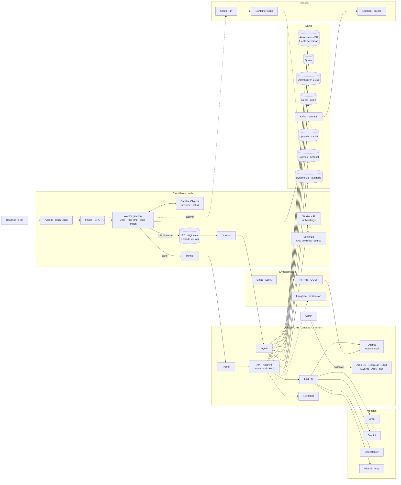

# Quimera

**Plataforma para construir, entrenar y operar agentes RAG gratis**, repartida en los free tiers de 21 proveedores y 5 nubes, con un costo objetivo de **USD 0/mes**. Es un proyecto personal, no comercial, pensado para hasta 50 personas.

> [!IMPORTANT]
> **Estado: fase F0** (repo, CI y estado remoto). La mayoría de las funciones descritas abajo están **diseñadas pero todavía no construidas**. Ver [Estado y pendientes](#estado-y-pendientes).

- Especificación completa: [`docs/quimera-spec.md`](docs/quimera-spec.md)
- Cupos verificados y presupuestos internos: [`docs/quotas.md`](docs/quotas.md)
- Decisiones: [`docs/decisions/`](docs/decisions/) · Runbooks: [`docs/runbooks/`](docs/runbooks/) · Reglas del proyecto: [`CLAUDE.md`](CLAUDE.md)

## Qué hace

**Agentes RAG**
- Chat con respuestas con **citas** a los documentos de origen, con streaming.
- **Recuperación híbrida:** vectores densos y sparse (Qdrant) + BM25 (OpenSearch), fusionados con Reciprocal Rank Fusion y reordenados con un cross-encoder.
- **GraphRAG:** entidades y relaciones extraídas a Neo4j para ampliar el contexto.
- **Enrutamiento de modelos por sensibilidad y cupo** (LiteLLM): los datos sensibles van solo al modelo local (Ollama). El resto va a Groq, después a Gemini y después a OpenRouter; los lotes nocturnos, a Mistral. Ante un 429 salta a la siguiente ruta.
- Caché de respuestas (Upstash) con la ACL del usuario dentro de la clave, e historial de conversaciones.

**Entrenamiento y evaluación**
- **Fine-tuning LoRA** en Colab (GPU T4 gratis), con datos propios o abiertos. Lo corrés a mano, como exigen los términos de Colab.
- El adapter y el **GGUF** se publican en Hugging Face Hub, y Ollama los descarga para servirlos dentro del cluster.
- **Trazas y evaluación de prompts** en Langfuse, sin trazar lo sensible.
- **Analítica** de uso, latencia y costo evitado por proveedor en BigQuery.

**Documentos**
- Subida desde el navegador con URL firmada a R2, limitada en tamaño y tipo de archivo.
- **Pipeline por eventos** (Kafka): parseo de PDF/DOCX en Lambda, OCR de escaneados en ZeroGPU, chunking, embeddings (Workers AI con fallback local del mismo modelo) e indexado.
- ACL por documento y bitácora de auditoría inmutable.

**Operación**
- **Failover en cascada:** OKE → Cloud Run → Container Apps → caché de preguntas frecuentes en Vectorize.
- **Todo se reconstruye** desde dos fuentes: los originales en R2 y la fuente de verdad en Oracle Autonomous DB.
- Login con Cloudflare Access (GitHub o Google), cero puertos abiertos (Cloudflare Tunnel) y admin por Tailscale.
- GitOps (Argo CD), secretos en OpenBao, imágenes multi-arch firmadas (cosign + Kyverno).
- Observabilidad en Grafana Cloud y Sentry; sondas externas (Gatus); alertas por mail y Telegram.
- Backups 3-2-1 (restic a OCI Object Storage y Backblaze B2, Data Pump de la base).
- **Cero cargos en la tarjeta:** presupuestos internos al 50 % de cada cupo, monitores y kill switches. Por ejemplo, [`quota-monitor`](apps/worker/quota-monitor) frena las subidas a R2 al 90 % del presupuesto.

## Arquitectura



**El ciclo de una pregunta:**
1. El Worker valida el JWT, aplica el rate-limit y consulta la caché.
2. Elige un origen sano.
3. La API recupera unos 40 candidatos (denso + BM25 + grafo), los reordena y se queda con los mejores.
4. Arma el prompt y LiteLLM lo envía al modelo según la sensibilidad y el cupo disponible.
5. La respuesta sale con citas y se guarda en el historial.

El detalle de los 63 componentes, los flujos, los cupos y qué falla primero está en la [especificación](docs/quimera-spec.md).

## Quickstart

> [!NOTE]
> Hoy solo se puede levantar F0: validación local, estado de OpenTofu en R2 y el monitor de cupo. El resto se suma fase por fase.

**Requisitos:**
- OpenTofu `~> 1.13` y Node 24.
- `tflint`, `trivy` y `gitleaks`. En Linux amd64 los instalás con checksum verificado: `scripts/install-ci-tools.sh ~/.local/bin tflint trivy gitleaks`.

**1. Validar en local.** No crea nada ni pide credenciales.

```sh
git clone <url-del-repo> quimera && cd quimera
tofu fmt -check -recursive
for m in infra/*/; do (cd "$m" && tofu init -backend=false -input=false && tofu validate); done
tflint --recursive --config "$PWD/.tflint.hcl"
trivy config --skip-dirs '**/.terraform' .
scripts/check-cost-guardrails.sh infra
gitleaks dir --redact .
(cd apps/worker && npm ci && npm run typecheck && npm test)
```

**2. Estado remoto en R2.** Necesitás una cuenta de Cloudflare con R2 habilitado (pide tarjeta). Seguí [`docs/runbooks/bootstrap-state.md`](docs/runbooks/bootstrap-state.md):

```sh
cd infra/bootstrap
export CLOUDFLARE_API_TOKEN=...      # token de bootstrap
export TF_VAR_account_id=...         # id de la cuenta de Cloudflare
export TF_VAR_state_passphrase=...   # passphrase de cifrado del estado (≥ 16 caracteres)
tofu init && tofu plan -out=tfplan && tofu apply tfplan
# después: migrar el estado a R2 y cargar los secrets de GitHub (pasos 2 y 4 del runbook)
```

**3. Monitor de cupo de R2.** Ver el paso 5 del runbook.

```sh
cd apps/worker/quota-monitor
npx wrangler login
npx wrangler kv namespace create quimera-guard   # pegar el id en wrangler.jsonc
npx wrangler secret put CF_ACCOUNT_ID
npx wrangler secret put CF_ANALYTICS_TOKEN       # = tofu output -raw quota_monitor_token (infra/bootstrap)
npx wrangler deploy
```

Los secretos nunca van al repo: en local viven en archivos `.env*` ignorados, y en CI en los secrets del Environment `production`.

## Estado y pendientes

Se arma por fases chicas, cada una verificable y reversible. Las marcadas con 🔒 tienen un gate: crean cuentas o recursos, o piden tarjeta, y necesitan aprobación explícita.

| Fase | Qué incluye | Estado |
|---|---|---|
| **F0** | Repo, CI, estado cifrado en R2, guardas de costo, `quota-monitor` | 🟡 Código listo. Falta 🔒 crear la cuenta de Cloudflare, el `apply` del bootstrap, migrar el estado y desplegar el monitor |
| **G1** | Oracle: home region y Pay As You Go | 🔒 Decisión irreversible pendiente |
| F2 | Red OCI privada, Vault, Object Storage, quotas de compartimento | ⏳ |
| F3 | Acceso admin: Micro A + Tailscale | ⏳ |
| F4 | Cluster OKE (2 × A1 arm64) | ⏳ |
| F5 | GitOps con Argo CD | ⏳ |
| F6 | Secretos: OpenBao + External Secrets | ⏳ |
| F7 | Cadena de suministro: cosign, Kyverno, GHCR multi-arch | ⏳ |
| F8 | Cloudflare Tunnel + Traefik | ⏳ |
| F9 | Cloudflare Access | ⏳ |
| F10 | Telemetría: Alloy + Grafana Cloud | ⏳ |
| F11 | Gateway de borde: Pages, Worker, Durable Objects | ⏳ |
| F12 | Fuente de verdad: Autonomous DB, migraciones, ACL | ⏳ |
| F13 | Subida de documentos: R2 + Queues + ingest | ⏳ |
| F14 | Eventos y parseo: Kafka, Lambda, DynamoDB | ⏳ |
| F15 | Índices: Workers AI, Qdrant, OpenSearch | ⏳ |
| F16 | Grafo y FAQ: Neo4j, Mistral, ZeroGPU, Vectorize | ⏳ |
| F17 | Modelos: LiteLLM, Ollama, reranker, Groq, Gemini, OpenRouter, Langfuse, HF Hub | ⏳ |
| F18 | Consulta completa: API, Cosmos, Upstash, Sentry | ⏳ |
| F19 | Réplicas: Cloud Run + Container Apps | ⏳ |
| F20 | Backups: restic, Data Pump, B2 | ⏳ |
| F21 | Analítica, sondas y automatizaciones: BigQuery, Gatus, n8n | ⏳ |
| F22 | Simulacro de failover | ⏳ |

**Riesgos abiertos** (detalle en la spec y en `docs/quotas.md`):
- La versión de Autonomous DB (26ai) y su disponibilidad por región se confirman antes de G1.
- Los 200 GB de disco de OCI se consumen con los boot volumes.
- El cupo de Groq rinde unas 40 respuestas por día, no 100.
- Las consultas sensibles no tienen failover fuera de OKE.

## Estructura

| Carpeta | Contenido |
|---|---|
| `infra/bootstrap/` | Bucket R2 del estado y tokens. Se aplica a mano (ver el runbook). |
| `infra/<proveedor>/` | Un módulo OpenTofu por proveedor (`oci`, `cloudflare`, `google`, `azure`, `aws`, `aiven`), con estado en R2. |
| `deploy/` | Argo CD (app-of-apps), charts y valores. Desde F5. |
| `apps/` | Servicios propios. Hoy: `worker/quota-monitor`. |
| `scripts/` | Utilidades de CI: guardas de costo e instalación verificada de herramientas. |
| `docs/` | Spec, cupos, runbooks y decisiones. |

## Reglas clave

- **Cero cargos en la tarjeta:** presupuesto interno del 50 % de cada cupo, monitores y kill switches.
- **Cero secretos en git:** los secretos viven en OpenBao, y en local en archivos `.env*` ignorados.
- **Nada se crea sin OK explícito:** el `apply` corre detrás de un Environment con aprobación manual.
- **Respeto de los términos de cada proveedor:** una cuenta por proveedor, Actions solo para CI/CD, Colab solo manual y nada sensible a modelos que entrenan con tus datos.

## Licencia

Copyright 2026 Rafael Santos. Distribuido bajo [Apache License 2.0](LICENSE).
